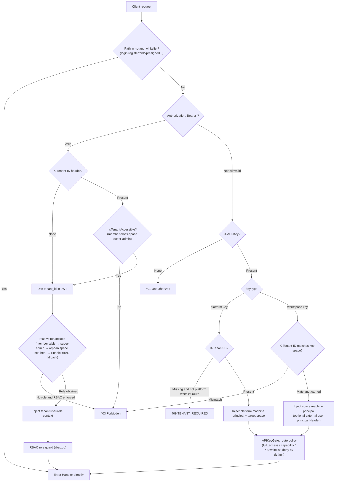

# API Overview

The WeKnora HTTP API uses the `/api/v1` prefix and supports JWT, API Key, and Embed token authentication; the built-in MCP Server endpoint uses endpoint token authentication separately. Before calling each resource endpoint, you need to choose credentials according to the client type and follow the unified response, error handling, pagination, and streaming event conventions.


For automation plans, execution records, and in-site notifications, see [Automation API](02-api-automations.md); these endpoints are only for logged-in users to manage their own tasks and do not accept API Keys.

## Base URL and Version Prefix

- All business APIs are mounted under the `/api/v1` prefix (`r.Group("/api/v1")` in `router.go`).
- Health check: `GET /health` (no authentication required), returns `{"status":"ok"}`.
- Swagger UI: the backend's `/swagger/index.html`, registered only in non-`release` mode (`GIN_MODE != release`). Docker Compose uses `release` by default; for enabling steps, backend port, and blank page troubleshooting, see [Development Guide](../06-development/01-dev-guide.md#_6-2-gin-mode-与-swagger).
- Special paths beyond authentication: `GET|HEAD /r/:token` (short-lived resource authorization URL), `GET /files` (authenticated file proxy), `GET|HEAD /api/v1/files/presigned` (HMAC-signed URL, no authentication required), `GET /api/v1/files/presigned-preview` (Admin diagnostics).

```
BASE=http://localhost:8080
```

When the VOS app is installed, the backend API is usually not directly mapped to a host port; instead, it is proxied by the VOS platform under `/app/com.ictrek.hybrag/`. When an external system needs to access it through the VOS gateway, write the Base URL as `https://<VOS address>/app/com.ictrek.hybrag/api/v1` (the specific value is subject to what is displayed on the frontend "API Integration" page); only when a standalone compose or debug deployment explicitly exposes the backend port should you use `http://<host IP>:<port>/api/v1`.

## Calling the HybRAG API in Non-VOS Scenarios

When HybRAG is installed as a VOS App, the frontend preferentially uses the current VOS user for automatic login; when external systems, scripts, third-party backends, or browser extensions run outside the VOS iframe, they can also directly call HybRAG's own REST API. External calls support two user identity paths: a regular user's personal API Key, or a regular user's VOS/OAuth Bearer token.

### Minimal Call Loop

1. Prepare the API address: `https://<your domain or gateway>/api/v1`. If accessing an intranet deployment directly, use the HybRAG backend address exposed by that deployment and keep the `/api/v1` prefix.
2. Prepare authentication: it is recommended that a regular user create their own personal API Key and send `X-API-Key: <api_key>` when calling; if the external application has already obtained that regular user's VOS token through VOS/OAuth login, it can also send `Authorization: Bearer <VOS access token>`, and HybRAG will verify it and inherit that user's permissions.
3. Create a session: `POST /sessions`, save the `data.id` in the response as the subsequent `session_id`.
4. Initiate a RAG Q&A: `POST /knowledge-chat/:session_id`, pass `query` in the request body, and pass `knowledge_base_ids` when you need to limit to knowledge bases.
5. Continuously read SSE: the endpoint returns `text/event-stream`, each `data:` is a `StreamResponse` JSON, and receiving `response_type:"complete"` indicates the end of the current round.

```bash
BASE=https://example.com/api/v1
API_KEY=sk_xxx

SESSION_ID=$(curl -s -X POST "$BASE/sessions" \
  -H "X-API-Key: $API_KEY" \
  -H 'Content-Type: application/json' \
  -d '{}' | jq -r '.data.id')

curl -N -X POST "$BASE/knowledge-chat/$SESSION_ID" \
  -H "X-API-Key: $API_KEY" \
  -H 'Content-Type: application/json' \
  -d '{"query":"What are the key points in this knowledge base?","knowledge_base_ids":["<knowledge_base_id>"],"channel":"api"}'
```

### Knowledge Base ID and Session ID

- `knowledge_base_ids` is written in the chat request body and is a string array; even when querying only one knowledge base, it is recommended to use the array form, for example `["kb-1"]`.
- `knowledge_base_id` is the legacy single-KB field of `POST /knowledge-search`; new integrations should uniformly use `knowledge_base_ids`.
- `session_id` comes from the response of `POST /sessions`. A session is used to store multi-turn context, message records, resume state, and title; when the same end user continues the conversation, reuse the same `session_id`, and a new topic can create a new one.
- If a restricted API Key is used, the `knowledge_base_ids` configured when the Key was created is the server-side permission boundary; the knowledge base IDs in the request body cannot cross this boundary.

### API Key / Token / Bearer Token

- **Regular user personal API Key:** A regular user creates their own Key on the API Integration page or via `POST /api/v1/tenants/:id/api-keys`. A personal Key is bound only to the current user, can be used at least for `retrieve`, `chat`, and `ingest`, and must be limited to the knowledge base scope accessible to that user. External applications send `X-API-Key: <api_key>` and do not need an admin/Owner to issue it on their behalf.
- **Workspace API Key:** Owner / cross-space administrators can create space-level full-access or management-capability Keys. Suitable for trusted backend services; if you need to distinguish end users, you can additionally configure `X-External-User-ID` or `X-External-User-Token`.
- **VOS/OAuth Bearer Token:** The external application first obtains the regular user's VOS access token through the VOS/OAuth login flow, then sends `Authorization: Bearer <VOS access token>`. HybRAG calls VOS `/v1000/oauth2/userinfo` for verification; on failure it falls back to the legacy `/v1000/user/check`. After successful verification, it is mapped to a HybRAG user and accesses knowledge bases according to that user's permissions.
- **HybRAG user JWT:** After obtaining a HybRAG access token via `POST /auth/login`, OIDC, or VOS token exchange, also send `Authorization: Bearer <token>`.
- **Whether an admin login is required to obtain a Token:** No. When an external application accesses a regular user's own knowledge bases, it should either use the personal API Key created by that regular user or use that regular user's VOS/OAuth Bearer token.

## Authentication Methods

Authentication is handled uniformly by the `Auth` middleware in `internal/middleware/auth.go`, attempted in the following order:

### JWT Bearer (Web Users) {#_1-jwt-bearer-web-用户}

```
Authorization: Bearer <access_token>
```

- Obtain `token` and `refresh_token` via `POST /api/v1/auth/login` (or register / OIDC; native desktop apps use auto-setup); `POST /api/v1/auth/refresh` issues a new token.
- Optional request header `X-Tenant-ID: <tenant_id>`: switch the target space outside the space pointed to by the JWT (must be an active member of that space, or have the `CanAccessAllTenants` cross-space super-admin attribute). Malformed or `0` values directly return 400.
- If the JWT does not resolve to any space and the endpoint is not in the "no space available" whitelist (such as `/auth/me`, `/me/invitations`, etc.), return 409 `{"code":"TENANT_REQUIRED"}`.

### API Key (Machine Principal) {#_2-api-key-机器主体}

```
X-API-Key: <api_key>
```

- Workspace-level key: created at `POST /api/v1/tenants/:id/api-keys`, bound to a single space; carrying `X-Tenant-ID` pointing to another space returns 403.
- Platform-level key: created at `POST /api/v1/system/admin/api-keys`, must carry `X-Tenant-ID` to select the target space (except `/system/admin/*`, `/tenants/all|search`, `POST /tenants`), otherwise return 409 `TENANT_REQUIRED`.
- Authorization model (`internal/middleware/api_key_gate.go`, deny by default): every `/api/v1` route must explicitly declare an API key policy; routes without a declaration return 403 for any key.
  - `full_access` key: full authority within the space (the machine form equivalent to Owner).
  - Restricted (scoped) key: allowed by capability and constrained by the `knowledge_base_ids` whitelist. Capability constants are in `internal/types/tenant_api_key.go`: `retrieve`, `ingest`, `chat`, `read_agents`, `manage_kbs`, `manage_agents`, `message_history`, `manage_models`, `manage_mcp_services`, `manage_datasources`, `manage_channels`, `manage_vector_stores`, `manage_storage_backends`, `manage_web_search`, `run_evaluations`, `manage_members`, `manage_spaces`, `manage_tenant_settings`; platform capabilities: `system_tenants_read/manage`, `system_settings_read/manage`, `system_runtime_read/manage`, `system_audit_read`.
- External user principal (optional, configured per space via `api-principal-config`):
  - `direct` mode: `X-External-User-ID: <external user ID>` (≤128 characters).
  - `signed_token` mode: `X-External-User-Token: <HS256 JWT>`, requiring `aud=weknora`, `exp` (lifetime ≤24h), a `tenant_id` claim consistent with the target space, and `sub` as the external user ID.

### Embed publish token (Anonymous Embed End) {#_3-embed-publish-token-匿名嵌入端}

The public routes under `/api/v1/embed/:channel_id/*` use a separate `EmbedAuth` middleware (`internal/middleware/embed_auth.go`):

```
Authorization: Embed <publish_token or session_token>
```

- `POST /embed/:channel_id/exchange` exchanges a publish token for a short-lived session token; session-level operations also require `X-Embed-Session: <sig>` (the signed handle returned when creating the session).
- IM callback routes (`/api/v1/im/callback/:channel_id`) are registered before the global authentication middleware and use each IM platform's own signature verification.

### MCP Endpoint Token (Built-in MCP Server)

`/mcp/:endpoint_id` (without the `/api/v1` prefix) is the MCP Streamable HTTP endpoint exposed externally by the space, verified by `internal/middleware/mcp_endpoint_auth.go`:

```
Authorization: Bearer <endpoint_token>
```

The token is displayed only once when creating an endpoint in "Settings → Publish Integration → MCP Server" and can be rotated. Requests execute as the machine principal of the space to which the endpoint belongs, with permissions limited to the tools and knowledge base scope checked on the endpoint. The endpoint management API is `/api/v1/mcp-endpoints` (Viewer+ to read, Admin+ to modify, API Key requires `manage_channels`); for usage, see [MCP Integration](../03-features/08-mcp.md).

### Authentication Flowchart



## Role and Permission Model (RBAC)

`internal/middleware/rbac.go` + `internal/middleware/access.go`:

| Role | Description |
| --- | --- |
| `owner` | Space owner: space lifecycle, API key, member management |
| `admin` | Space administrator: space-level configuration such as models/infrastructure/channels |
| `contributor` | Contributor: can create KB/Agent, can modify resources **they created** |
| `viewer` | Read-only member: reading and session usage |
| SystemAdmin | Platform-level administrator (`User.IsSystemAdmin`), independent of space roles, guards `/system/admin/*`, always enforced |

- "Viewer+ / Contributor+ / Admin+ / Owner" in the documentation indicates the minimum role requirement; "creator OR Admin+" corresponds to `RequireOwnershipOrRole` (Contributor can only modify KB/Agent/content they created).
- When `cfg.Tenant.EnableRBAC=false`, role guards only log and do not block (rollout fail-open); the SystemAdmin guard is not affected by this switch.
- KB-level access guard `KBAccessRead/Write` (`internal/middleware/kb_access.go`): resolves three types of access—"own / organization-shared / visible via shared Agent"—and rewrites the tenant in the request context to the KB owner space.
- API key principals short-circuit the JWT role guard; their actual permissions are entirely determined by APIKeyGate (capability + KB whitelist).
- Rejected requests are written to the audit log (`middleware.AuditServiceProvider`, deduplicated within a 1-minute sliding window).

## Common Response Format and Error Codes

Most handlers return:

```json
{ "success": true, "data": { ... } }
```

List endpoints commonly have additional fields: `total`, `page`, `page_size`. A few exceptions: some read endpoints under `/system/admin/*` directly return raw rows/arrays (without wrapping), and `/system/info` etc. use `{"code":0,"msg":"success","data":...}`.

Errors are output uniformly by `internal/middleware/error_handler.go` (`AppError` in `internal/errors/errors.go`):

```json
{ "success": false, "error": { "code": 1003, "message": "...", "details": null } }
```

The middleware layer (authentication/RBAC) directly returns `{"error": "..."}` (some with a `"code"` string, such as `TENANT_REQUIRED`).

| Error Code | Meaning | HTTP |
| --- | --- | --- |
| 1000 | ErrBadRequest bad request | 400 |
| 1001 | ErrUnauthorized unauthenticated | 401 |
| 1002 | ErrForbidden no permission | 403 |
| 1003 | ErrNotFound resource does not exist | 404 |
| 1004 | ErrMethodNotAllowed | 405 |
| 1005 | ErrConflict conflict | 409 |
| 1006 | ErrTooManyRequests rate limit/quota | 429 |
| 1007 | ErrInternalServer internal error | 500 |
| 1008 | ErrServiceUnavailable temporarily unavailable | 503 |
| 1009 | ErrTimeout timeout | — |
| 1010 | ErrValidation parameter validation failed | 400 |
| 2000-2005 | Space category: does not exist/already exists/disabled/name required/invalid status/self-service creation disabled | 404/409/403/… |
| 2100-2103 | Agent category: missing thinking model/missing allowed tools/invalid iteration count (1-20)/invalid temperature (0-2) | 400 |
| 2200-2201 | VectorStore binding invalid / currently unavailable | 400 |

There are also non-coded errors: `types.StorageQuotaExceededError` (storage quota exceeded), `types.DuplicateKnowledgeError` (duplicate file/URL; the upload endpoint returns 409 and `data` carries the existing Knowledge).

## Pagination Specification

`internal/handler/list_pagination.go`:

| Parameter | Type | Required | Description |
| --- | --- | --- | --- |
| `page` | int | No | Page number, default 1, must be ≥1 |
| `page_size` | int | No | Number of items per page, default 20, range 1-100 |

Out-of-range or invalid values return a validation error (code 1010). List responses carry `total/page/page_size`. Some endpoints use cursor pagination: audit logs (`after_id`+`limit`, response carries `next_cursor`), system runtime tasks (`cursor`+`page_size`, response carries `next_cursor/has_more`), Wiki index/log (`cursor`+`limit`).

## Streaming Endpoint Protocol (SSE)

Chat endpoints (`POST /api/v1/knowledge-chat/:session_id`, `POST /api/v1/agent-chat/:session_id`, `GET /api/v1/sessions/continue-stream/:session_id`, and the corresponding embed routes) return Server-Sent Events:

```
Content-Type: text/event-stream
Cache-Control: no-cache
Connection: keep-alive
X-Accel-Buffering: no
```

Each event is `event: message`, and `data:` is a `types.StreamResponse` JSON:

| Field | Type | Description |
| --- | --- | --- |
| `id` | string | Request ID |
| `response_type` | string | `answer` / `references` / `thinking` / `tool_call` / `tool_result` / `command_output` / `reflection` / `session_title` / `agent_query` / `artifacts_pending` / `memory_recalled` / `user_message_injected` / `context_compacted` / `tool_approval_required` / `tool_approval_resolved` / `mcp_oauth_required` / `mcp_oauth_resolved` / `error` / `complete`; the skill installation record stream additionally has `install_prompt` / `install_output` |
| `content` | string | Incremental text |
| `done` | bool | Whether this type of event has ended |
| `knowledge_references` | []SearchResult | References carried by the `references` event |
| `tool_calls` | []LLMToolCall | Tool call events |
| `data` | object | Additional event metadata (such as `success` of a tool result, `truncated` of an answer) |
| `session_id` / `assistant_message_id` | string | Carried by the `agent_query` event |
| `usage` | TokenUsage | `prompt_tokens/completion_tokens/total_tokens/cache_*` |
| `finish_reason` | string | Finish reason |

`source_locators` in `SearchResult` (`knowledge_references`, results of retrieval endpoints) is the position of the chunk in the original file, which can be used to locate the reference in the original text (empty for documents ingested before this feature went live):

| Field | Applicable `type` | Description |
| --- | --- | --- |
| `type` | — | `pdf` / `docx` / `slide` / `sheet` / `text` / `time` / `section` |
| `page`, `bbox` | `pdf` | Page number (starting from 1); `bbox` is `[x0,y0,x1,y1]`, a ratio relative to the page width and height, with the origin at the top-left corner of the page, may be omitted |
| `block` | `docx` | Which paragraph or table in the body (starting from 1) |
| `slide` | `slide` | Which slide (starting from 1) |
| `sheet`, `row_start`, `row_end` | `sheet` | Worksheet name (empty for CSV) and row numbers (starting from 1, same as Excel row numbers) |
| `start`, `end` | `text` | Character range of the original file text (Unicode code points) |
| `start_ms`, `end_ms` | `time` | Audio time range (milliseconds) |
| `section`, `title` | `section` | Which item in the EPUB spine (starting from 1) and the chapter title |
| `quote` | All | The quoted text, up to 300 characters |

Numeric fields with a value of 0 are omitted. Merged retrieval results carry the union of the positions of the merged chunks.

The stream terminates with `response_type:"complete"` (`done:true`); on error it terminates with `response_type:"error"` (`done:true`). Tool execution failures are returned as `tool_result` (`data.success=false`); `error` only indicates the entire round failed; when an answer is truncated due to the output limit, the `answer` event carries `data.truncated=true`. `continue-stream` uses replay + 100ms polling to catch up on increments as its resume semantics (`?message_id=` is required).

## File Reference Form (resource_urls)

Images/attachments referenced in answers and retrieval results are returned by default as the internal handle `resource://<handle>`, and the client must call the authenticated `/files` proxy again to get the content. When a third-party App wants a "render-ready" link, it can switch to direct-link mode:

| Scope | Usage |
| --- | --- |
| Single request | Add `?resource_urls=public` to the URL |
| Entire deployment | Environment variable `RESOURCE_URL_MODE=public` |

The only valid values are `handle` (default) and `public`; passing any other value returns 400. The per-request parameter takes precedence over the environment variable, so after setting the deployment default to `public`, you can still use `?resource_urls=handle` to fall back individually.

Endpoints that support this parameter: `POST /knowledge-chat/{session_id}`, `POST /agent-chat/{session_id}`, `GET /sessions/continue-stream/{session_id}`, `GET /messages/{session_id}/load`, `POST /knowledge-search`, `POST /knowledge-bases/{id}/hybrid-search` (GET compatible). The rewriting covers the answer body, retrieval result `content` / `image_info`, `knowledge_references`, Agent execution steps and tool results, and image attachments on messages; references truncated across chunks in streaming answers are buffered first and then rewritten, so the client always receives complete links.

A few things to know before use:

- **External link capability is required**: direct links come from storage backend presigning, or `APP_EXTERNAL_URL` + `/r/<token>`. When neither is available (such as local storage without `APP_EXTERNAL_URL` set), the reference remains as `resource://` and the client can still fall back to `/files`;
- **Direct links are time-limited and anonymously readable** (WeKnora-issued grants last 2 hours, MinIO presigned URLs last 24 hours); anyone who obtains the link can read it before expiration, so do not write it into logs or forward it to people who should not see it;
- **Embed channels are not supported**: endpoints under `/api/v1/embed/...` force `handle`, and visitor images continue to go through the channel-dimension authenticated proxy;
- **Using `public` with a knowledge-base-restricted API Key returns 403**: such Keys are themselves prohibited from accessing the `/files` proxy, and being able to obtain anonymous direct links would amount to bypassing the same restriction;
- **Direct links for the same file are reused within the validity period**; repeated requests do not re-issue credentials, so client and CDN caches can hit.

For which form each channel (Web / IM / embed widget / API) receives, and how to troubleshoot when images fail to load, see [External Access to Images and Files](../03-features/21-file-access.md).

## How to Choose a Retrieval Endpoint {#retrieval-api}

There are two retrieval endpoints exposed externally; both require the API Key to have `retrieve` (or full) permission, and both return a list of `SearchResult`.

**Use `POST /knowledge-search` by default**. It follows the same retrieval pipeline as in-product Q&A (recall → rerank → merge → truncate), and returns exactly the snippets that the page's Q&A would use. `POST /knowledge-bases/{id}/hybrid-search` is a lower-level recall endpoint: by default it does not rerank, and the score is the recall score, suitable for scenarios where you need to see or control the raw recall results.

### Choose by Scenario

| I want to… | Which to use | Request body key points |
| --- | --- | --- |
| Get retrieval results for my own RAG / agent, with ranking consistent with page Q&A | `knowledge-search` | `query` + `knowledge_base_ids`, leave the rest empty |
| Search multiple knowledge bases at once, and they use different embedding models | `knowledge-search` | `knowledge_base_ids` |
| Search only within certain documents or tags | `knowledge-search` | `knowledge_ids` / `tag_ids`; when searching only specified documents, do not also pass the `knowledge_base_ids` they belong to—the two are unioned |
| Adjust the number of returned items or the recall threshold, but still want rerank | `knowledge-search` | `match_count`, `vector_threshold`, `keyword_threshold` |
| Use a different rerank model, or change the rerank threshold | `knowledge-search` | `rerank.model_id`, `rerank.threshold` |
| Do not rerank, take the recall results directly | `knowledge-search` or `hybrid-search` | The former passes `"rerank":{"enabled":false}`; the latter does not pass `rerank` |
| Results are empty and I want to know why | `knowledge-search` | Look at `meta.rerank.outcome` in the response |
| I have already computed the query vector myself | `hybrid-search` | `query_embedding` + `disable_keywords_match: true` |
| Evaluate recall quality: fix one KB, fix parameters, look at raw recall scores | `hybrid-search` | Do not pass `rerank` |
| On top of the above evaluation, compare the effect after adding rerank | `hybrid-search` | Add `rerank` to the same request |
| Parent chunks and adjacent chunks should be returned as separate result rows rather than spliced into the body | `hybrid-search` | This is the default; `skip_context_enrichment: true` can disable it |

### Differences Between the Two

| | `knowledge-search` | `hybrid-search` |
| --- | --- | --- |
| rerank | On by default (uses space configuration); the `rerank` object can override or disable | Off by default; only enabled when the `rerank` object is passed |
| Multiple knowledge bases | Yes, embedding models may differ | `knowledge_base_ids` is allowed, but embedding models must be the same, and the `{id}` in the path must also be among them |
| Precomputed vector | Not supported | `query_embedding` |
| Context chunks | Merged into the result's `content` | Returned as additional result rows |
| When `match_count` is omitted | The space-configured `rerank_top_k` (default 10) | 50 |
| `meta.rerank` | Returned every time | Returned only when `rerank` is passed |

The recall parameters of the two endpoints (`vector_threshold`, `keyword_threshold`, `match_count`, `disable_keywords_match`, `disable_vector_match`) and the `rerank` object have the same meaning; parameters omitted by `knowledge-search` inherit the space's retrieval configuration (`GET /tenants/kv/retrieval-config`).

### The rerank Object

The `rerank` field structure is the same for both endpoints:

| Field | Type | Default | Description |
| --- | --- | --- | --- |
| `enabled` | bool | `true` | Set to `false` to disable rerank; results keep the recall order |
| `model_id` | string | See below | Rerank model ID (models with `type` `Rerank` in `GET /models`). If the ID does not exist, is not activated, or is not a rerank model, returns 400 and will not silently switch to another model |
| `top_k` | int | The endpoint's return count | Maximum number to keep after rerank; negative numbers or values over 200 return 400 |
| `threshold` | float | `rerank_threshold` in the space retrieval configuration (0.2 when not configured) | Model score lower bound; `0` and negative numbers are both valid values |

When `model_id` is not passed, the following are used in order: `rerank_model_id` in the space retrieval configuration → the first rerank model in the space. If neither exists, no rerank is performed, results are returned in recall order, and `meta.rerank.outcome` is `no_model`.

The rerank process shares the same implementation (`internal/reranking`) with the Q&A pipeline and the `search_knowledge` tool of intelligent reasoning:

1. The text sent to the model for scoring = document title + chunk body with Markdown markers removed + image description and OCR text + generated questions. FAQ entries do not add the title. When the model configuration has a per-document or per-request length limit (`max_document_chars` / `max_request_chars`), overly long text is truncated from the tail to the limit before being sent; the appended image text and generated questions are truncated first; an overly long single text will not cause the entire batch scoring to fail.
2. Keep results with a score not lower than `threshold`. If there are none and `threshold` is higher than 0.3, lower the threshold to `max(threshold×0.7, 0.3)` and filter again. If there are still none, keep only the single highest-scoring one when its score is not lower than 0.15; otherwise return an empty list.
3. Ranking score = `0.6×model score + 0.3×recall score + 0.1×source weight`; the result's `metadata` carries `model_score` and `base_score`.
4. Use MMR (λ=0.7) to select `top_k` items from them, reducing content duplication.

Image vector hits can also be reranked by the original image: this requires the rerank model to declare and implement image input; ordinary text rerank still uses text information; vision chat models can receive the retained hit images. For the retention and context rules of image candidates, see [Retrieval Q&A Pipeline](../02-architecture/04-rag-pipeline.md).

When `hybrid-search` enables rerank, the recall depth is at least the same as `top_k`, and the candidate pool is the top `max(top_k, 50)` chunks after fusion, so even a small `match_count` still has enough candidates for the model to choose from.

When the rerank model fails to load or the call errors out, the request does not fail; instead, results are returned in recall order, and the reason is stated in `meta.rerank`.

### meta.rerank Diagnostics

The `knowledge-search` response always carries `meta.rerank`; `hybrid-search` carries it only when the request includes the `rerank` object.

```json
{
  "success": true,
  "data": [],
  "meta": {
    "rerank": {
      "applied": true,
      "outcome": "all_below_threshold",
      "model_id": "rr-1",
      "model_source": "tenant",
      "threshold": 0.3,
      "effective_threshold": 0.3,
      "top_score": 0.08,
      "candidate_count": 24,
      "result_count": 0
    }
  }
}
```

| Field | Description |
| --- | --- |
| `applied` | Whether the rerank score determined the return order |
| `outcome` | See the table below |
| `model_id` / `model_source` | The model used, and where it came from: `request` (specified by request), `tenant` (space configuration), `auto` (automatically selected) |
| `threshold` / `effective_threshold` | The requested threshold, and the threshold actually used after degradation |
| `top_score` | The highest model score among candidates |
| `candidate_count` / `result_count` | Number of candidates sent to rerank / number of returned items |
| `error` | Error message for `model_error`, `model_unavailable` |

| `outcome` | Meaning |
| --- | --- |
| `ok` | Some results reached the threshold |
| `threshold_degraded` | No results under the original threshold; results appeared only after lowering the threshold |
| `fallback_top1` | No threshold was passed, so only the single highest-scoring item was kept |
| `all_below_threshold` | The model considers no candidate relevant, and the result is empty. You can rephrase the question or lower `rerank.threshold` |
| `model_error` | Model call failed; results returned in recall order |
| `model_unavailable` | Model failed to load (credential, address, or other configuration issues); results returned in recall order |
| `no_model` | There is no rerank model in the space; results returned in recall order |
| `disabled` | `rerank.enabled` in the request is `false` |
| `no_candidates` | No results in the recall stage |

## Rate Limiting

| Surface | Limit | Source |
| --- | --- | --- |
| Public share link endpoints (`/auth/invitations/lookup`, `/auth/register-by-invite`) | 30 requests per minute per IP (the two endpoints share the quota); exceeding returns 429 (code 1006) | `internal/middleware/auth_public_ratelimit.go` |
| Embed public routes | Per (channel, IP) `rate_limit_per_minute` (default 30)/minute; channel-level `rate_limit_per_minute*20` (minimum 120)/minute; channel-level `rate_limit_per_day` (default 10000)/day; exceeding returns 429 | `internal/middleware/embed_auth.go` |
| Reverse proxy trust | Only trust `X-Forwarded-For` from `WEKNORA_TRUSTED_PROXIES` (default loopback + intranet ranges) to prevent forged IPs from bypassing rate limits | `router.go` `trustedProxies()` |

Other business endpoints have no global rate limiting; quota-type rejections such as self-service space creation also use 429 (code 1006).

## API Group Navigation

| Group | Documentation | Main Prefixes |
| --- | --- | --- |
| Authentication and Users | [02-api-auth.md](./02-api-auth.md) | `/auth`, `/me/invitations` |
| Tenants (Spaces) and Members | [02-api-tenant.md](./02-api-tenant.md) | `/tenants` |
| Organizations and Sharing | [02-api-org.md](./02-api-org.md) | `/organizations`, `/shared-*`, `/knowledge-bases/:id/shares`, `/agents/:id/shares` |
| Knowledge Bases and Knowledge | [02-api-knowledge.md](./02-api-knowledge.md) | `/knowledge-bases`, `/knowledge`, knowledge base folders, gallery, `/image-attrs/schema` |
| Chunks and Tags | [02-api-chunks.md](./02-api-chunks.md) | `/chunks`, `/knowledge-bases/:id/tags`, `/chunker/preview` |
| FAQ and Wiki | [02-api-faq-wiki.md](./02-api-faq-wiki.md) | `/knowledge-bases/:id/faq`, `/faq`, `/knowledgebase/:kb_id/wiki`, `/wiki-search` |
| Sessions, Messages, and Chat | [02-api-chat.md](./02-api-chat.md) | `/sessions`, `/messages`, `/knowledge-chat`, `/agent-chat`, `/knowledge-search` |
| Models and Initialization | [02-api-model-system.md](./02-api-model-system.md) | `/models`, `/initialization`, `/evaluation`, `/weknoracloud` |
| System and Platform Management | [02-api-system.md](./02-api-system.md) | `/system`, `/system/admin` |
| Infrastructure and Data Sources | [02-api-infra.md](./02-api-infra.md) | `/vector-stores`, `/storage-backends`, `/web-search-providers`, `/datasource` |
| Agent and MCP | [02-api-agent-mcp.md](./02-api-agent-mcp.md) | `/agents`, `/mcp-services`, `/agent`, `/user/favorites` |
| Built-in MCP Server | [MCP Integration](../03-features/08-mcp.md) | `/mcp-endpoints`, `/mcp/:endpoint_id` |
| Local Browser | [Local Browser](../05-clients/09-local-browser.md) | `/me/browser`, `/local-browser` |
| Sandbox, Skills, and Personal Variables | [02-api-sandbox-skills.md](./02-api-sandbox-skills.md) | `/sandbox-configs`, `/skills`, `/me/env-vars` |
| Long-term Memory | [02-api-memory.md](./02-api-memory.md) | `/memory`, `/tenants/kv/memory-config` |
| IM, Embed, and File Services | [02-api-channels.md](./02-api-channels.md) | `/im`, `/im-channels`, `/wechat`, `/embed-channels`, `/embed`, `/files`, `/r/:token` |

For new configuration and personal endpoints, see [Sandbox, Skills, and Personal Variables](02-api-sandbox-skills.md) and [Long-term Memory](02-api-memory.md); for generated file listing and download, see [Sessions and Chat](02-api-chat.md).
